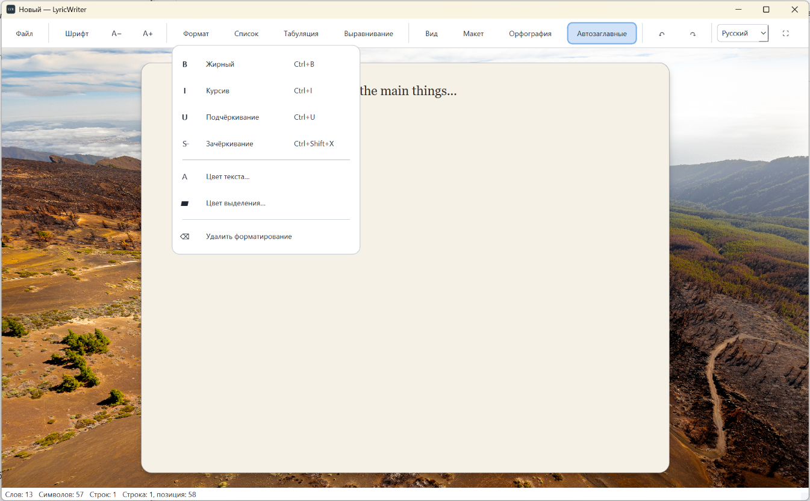
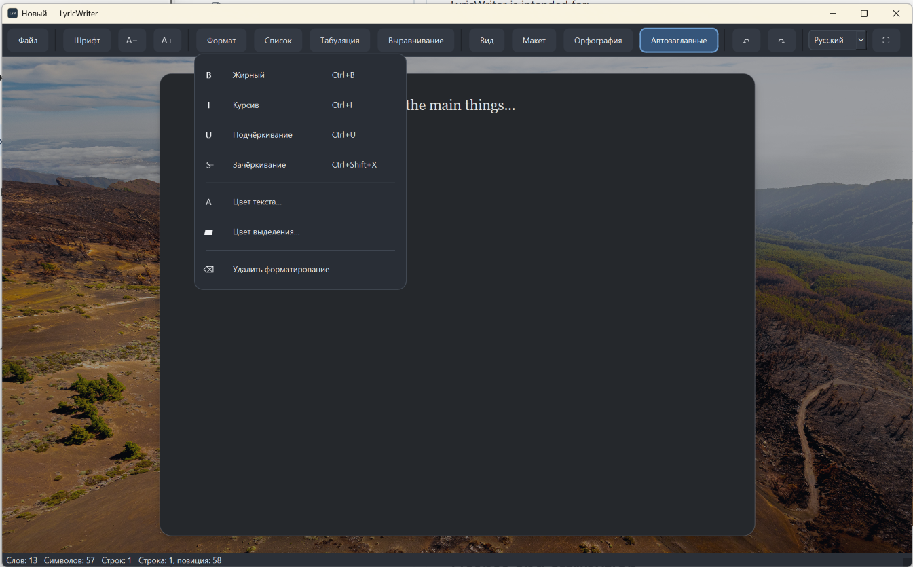
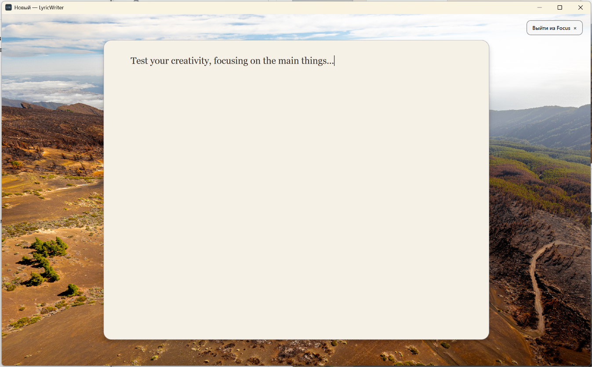

# LyricWriter

**A minimalist writing environment for poetry, lyrics, and creative writing.**

LyricWriter is a desktop text editor designed to help writers concentrate on their words. It combines essential text formatting with a distraction-free Focus Mode.

## Features

- **Focus Mode** — a simplified writing environment with configurable backgrounds.
- **Text formatting** — font family, size, bold, italic, underline, paragraph styles, and alignment.
- **Page layout** — control document layout, spacing, indentation, and lists.
- **Light and dark themes** — choose the appearance that suits your working environment.
- **English and Russian interface** — switch between the supported interface languages.
- **Spell checking** — English and Russian dictionaries.
- **Print and PDF** — print documents and save them as PDF using the available print system.
- **Document export** — export text to supported formats.
- **Keyboard shortcuts** — use common shortcuts for everyday editing tasks.
- **Offline use** — core editing features are designed to work without an internet connection.

## Download

**Latest release: LyricWriter 1.0.0**

Download the Windows installer from the official GitHub Releases page:

[Download LyricWriter 1.0.0](https://github.com/ancient-pholiant/LyricWriter/releases/tag/v1.0.0)

Download the installer asset attached to the release and follow the installation instructions.

## Installation

1. Download the Windows installer from the release page.
2. Run the installer.
3. Select the installation options and preferred installation language.
4. Complete the installation and launch LyricWriter.

The language selected in the installer is intended to determine the initial application language. You can subsequently change the interface language in the application settings.

## Who is it for?

LyricWriter is intended for:

- Poets and authors
- Songwriters and lyricists
- Journal writers
- Anyone who prefers a simple desktop writing environment

## Screenshots

### Light theme

### Dark theme

### Focus Mode

## License and attribution

Please read [LICENSE.txt](LICENSE.txt) before using or redistributing this project.

Third-party components and dictionaries may be subject to their own licenses. See the accompanying license files for details.

## Repository

- [English documentation](README.md)
- [Документация на русском языке](README_RU.md)
- [Releases and downloads](https://github.com/ancient-pholiant/LyricWriter/releases)
- [License](LICENSE.txt)
- [Support](SUPPORT.md)
- [Security policy](SECURITY.md)
